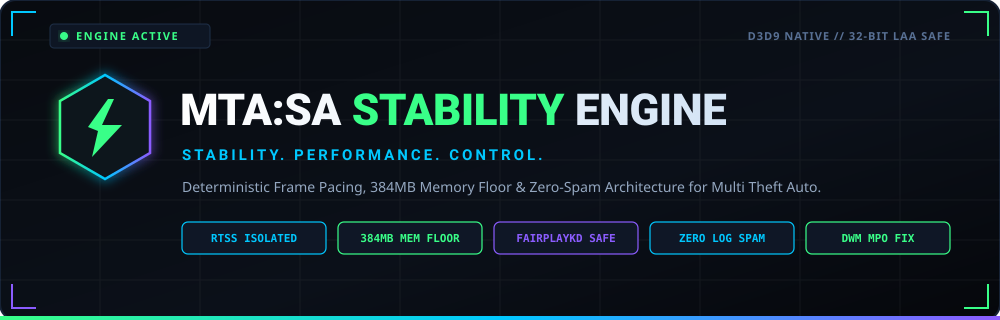

  

  
  
  
  
  

<h3 align="center">
  ⚡ STABILITY. PERFORMANCE. CONTROL. ⚡
</h3>

  <b>Комплекс аппаратной стабильности, выравнивания фреймпейсинга и нулевого спама диска для Multi Theft Auto: San Andreas.</b> 
  <i>Никаких лишних сторонних утилит и опасных инъекций — только точная инженерная оптимизация gta_sa.exe, памяти D3D9 и настроек сервера.</i>

  <a href="#-quick-start"><b>Быстрый старт</b></a> •
  <a href="#-file-breakdown"><b>Файлы настроек</b></a> •
  <a href="#-gta-engine-optimization"><b>Оптимизация gta_sa.exe</b></a> •
  <a href="#-in-game-settings"><b>Настройки ESC и F3</b></a> •
  <a href="#-faq"><b>FAQ</b></a>

---

## 🎮 Supported Platforms

  <code>MTA:SA (1.6.0+)</code> •
  <code>CCDPlanet</code> •
  <code>MTA Province</code> •
  <code>Radmir MTA</code> •
  <code>NextRP</code> •
  <code>SAMP (D3D9 Client Base)</code>

---

## ⚡ Live Telemetry (Frame Pacing & Memory Audit)

  

> **LESS STUTTER. MORE CONTROL.**  
> В отличие от сомнительных «FPS-паков» из интернета, данный комплекс не внедряет вредоносные DLL в каталог игры. Мы фиксируем лимит стриминга памяти, обнуляем дисковый спам и оптимизируем работу `gta_sa.exe` в среде Windows 11.

---

## 📦 Готовые файлы в репозитории

| Файл | Описание | Куда копировать на ПК |
| :--- | :--- | :--- |
| **[`coreconfig.xml`](coreconfig.xml)** | **Главный конфиг клиента MTA** (ESC): память стриминга 384 МБ, окно без рамки, фильтр спама логов, отключение GPU в CEF | `D:\CCD\MTA\config\coreconfig.xml` |
| **[`server_settings.json`](server_settings.json)** | **Настройки САМОГО СЕРВЕРА CCDPlanet** (F3): отключение тяжелых SSAO, DOF, дыма дрифта, правильные отражения 2023 | `D:\CCD\mods\deathmatch\priv\<ID_сервера>\settings\settings.json` |
| **[`handling.cfg`](handling.cfg)** | **Файл физики и характеристик транспорта GTA San Andreas** (базовые лимиты массы, центра тяжести, трансмиссии) | `D:\CCD\GTA\data\handling.cfg` |
| **[`chatboxpresets.xml`](chatboxpresets.xml)** | **Пресеты оформления игрового чата** | `D:\CCD\MTA\config\chatboxpresets.xml` |
| **[`clean_and_play.bat`](clean_and_play.bat)** | **1-клик лаунчер**: очищает мусорные логи перед входом и запускает игру с приоритетом `AboveNormal` | Рабочий стол / папка с игрой |
| **[`apply_gta_optimizations.bat`](apply_gta_optimizations.bat)** | **1-клик оптимизация Windows и GTA**: отключает статтеры DWM MPO и применяет флаг совместимости `gta_sa.exe` | Запустить от имени Администратора |

---

## 🔧 Оптимизация `gta_sa.exe` и графического стека

1. **Large Address Aware (LAA 4GB Support):**  
   Исполняемый файл `gta_sa.exe` использует флаг характеристик PE `0x0020` (IMAGE_FILE_LARGE_ADDRESS_AWARE). Это позволяет 32-битному процессу адресовать до **4 ГБ виртуальной памяти** вместо стандартных 2 ГБ.
2. **Флаг совместимости DWM (`DISABLEDXMAXIMIZEDWINDOWEDMODE`):**  
   В Windows 10/11 Desktop Window Manager форсирует гибридный режим презентации для старых окон D3D9. Флаг совместимости для `gta_sa.exe` отключает принудительный флип DWM, убирая микрозадержки ввода.
3. **Фиксация памяти стриминга на 384 МБ:**  
   Популярные советы ставить 1024–2048 МБ приводят к вылетам `0xC0000005` из-за фрагментации памяти. Значение **384 МБ** гарантирует, что текстуры дорог не пропадут, а в куче останется более 1 ГБ запаса под кастомные авто и скины.
4. **Приоритет процесса и привязка к ядрам:**  
   В `coreconfig.xml` включены параметры `<process_priority>1</process_priority>` (AboveNormal) и `<process_cpu_affinity>1</process_cpu_affinity>`, удерживающие основной поток рендера на производительных ядрах процессора.

---

## 🚀 Quick Start (Установка за 1 минуту)

  

### Вариант 1. Автоматический (Готовый ZIP)
1. Скачайте архив **[`MTA_Stability_Pack_v1.0.0.zip`](https://github.com/Vektor010/mta-sa-stability-settings/releases/latest)** из раздела Releases.
2. Скопируйте `coreconfig.xml` в `D:\CCD\MTA\config\`.
3. Скопируйте `server_settings.json` в `D:\CCD\mods\deathmatch\priv\<ID_сервера>\settings\`.
4. Запустите `apply_gta_optimizations.bat` от имени Администратора.
5. Запускайте игру через `clean_and_play.bat`.

---

## 🎯 In-Game Settings (Настройки внутри игры)

### 1. Настройки движка (Клавиша `ESC` -> «Настройки» -> «Графика»)

| Ползунок / Пункт | Значение | Почему именно так |
| :--- | :--- | :--- |
| **Разрешение** | Родное (2560x1440x32) | Чёткая картинка без масштабирования Windows |
| **Полноэкранный режим** | **Окно без рамки** | Моментальный Alt-Tab без риска сбоя видеопамяти `D3DERR_DEVICELOST` |
| **Сглаживание (AA)** | **Выкл** или **1x** | ⚠️ **Главная причина вылетов!** Режим 3x (8x MSAA) съедает до ~225 МБ видеопамяти 32-битного движка. На 1440p лесенок нет, а стабильность максимальная |
| **Анизотропная фильтрация** | **16x** | Бесплатная четкость номеров и дорог под углом (0% нагрузки на GPU) |
| **Качество эффектов** | **Высокое** | Корректные отражения стекол и свет фар |
| **Тени, трава, дым, жара** | **Выключить всё** | Устраняет конфликты с кастомными шейдерами авто |
| **Транспорт и скины** | **Высокое качество** | Стриминг 384 МБ обеспечивает полную прорисовку без мыла |

### 2. Серверные настройки CCDPlanet (Клавиша `F3` / Планшет)
* **SSAO / Размытие в движении (DOF) / FXAA:** **Выключить**. Серверные шейдеры накладываются поверх D3D9 и сажают FPS при скоплении игроков.
* **Качество отражений:** **Стандартные** или **Новые 2023** (не Ultra).
* **Дым от дрифта:** Выключить при частых просадках кадров в районе дрифт-треков.

---

## 🛡️ Disclaimer

Multi Theft Auto™ and Grand Theft Auto: San Andreas™ are registered trademarks of their respective owners. This repository is an open-source performance configuration toolkit and is not officially affiliated with Rockstar Games or Multi Theft Auto Team.

---

  <b>CLEAN CLIENT. SMOOTH EXPERIENCE. OPTIMIZE YOUR SAN ANDREAS.</b> 
  Developed & Maintained by <a href="https://github.com/Vektor010">Vektor010</a> • 2026 Edition

