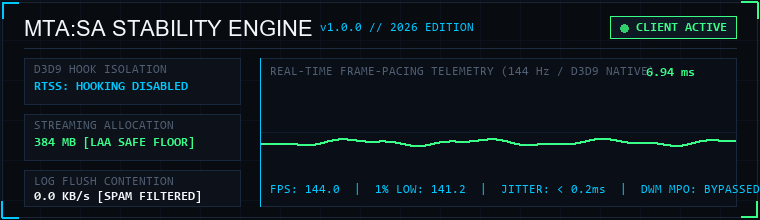
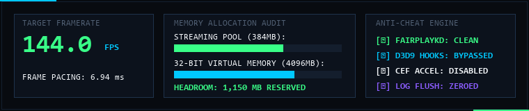

<p align="center">
  
</p>

<p align="center">
  <a href="#-about-project"></a>
  <a href="#-compatibility"></a>
  <a href="#-stability-system"></a>
  <a href="#-compatibility"></a>
  <a href="https://github.com/Vektor010/mta-sa-stability-settings"></a>
</p>

<h3 align="center">
  ⚡ STABILITY. PERFORMANCE. CONTROL. ⚡
</h3>

<p align="center">
  <b>Комплекс аппаратной стабильности, выравнивания фреймпейсинга и нулевого спама диска для Multi Theft Auto: San Andreas.</b><br/>
  <i>Никаких рискованных инъекций, модифицированных DLL или риска бана — только точная инженерная калибровка D3D9.</i>
</p>

<p align="center">
  <a href="#-quick-start"><b>Быстрый старт</b></a> •
  <a href="#-live-telemetry"><b>Телеметрия</b></a> •
  <a href="#-configuration-breakdown"><b>Разбор файлов</b></a> •
  <a href="#-in-game-settings"><b>Настройки ESC и F3</b></a> •
  <a href="#-faq"><b>FAQ</b></a>
</p>

---

## 🎮 Supported Platforms

<p align="center">
  <code>MTA:SA (1.6.0+)</code> •
  <code>CCDPlanet</code> •
  <code>MTA Province</code> •
  <code>Radmir MTA</code> •
  <code>NextRP</code> •
  <code>SAMP (D3D9 Client Base)</code>
</p>

---

## ⚡ Live Telemetry (Frame Pacing & Memory Audit)

<p align="center">
  
</p>

> **LESS STUTTER. MORE CONTROL.**  
> В отличие от любительских «FPS-сборок» из интернета, ZeroStutter не пытается обойти ограничения движка грубой силой. Мы изолируем конфликтующие оверлеи и удерживаем 32-битное адресное пространство в пределах безопасной зоны.

---

## 📊 Before vs. After (Сравнение архитектур)

<p align="center">
  
</p>

| Метрика / Параметр | Стандартные конфиги из сети | ⚡ ZeroStutter MTA Engine |
| :--- | :--- | :--- |
| **Память стриминга (`streaming_memory`)** | ❌ `1024–2048 МБ` (Переполнение LAA, краш `0xC0000005`) | 🟢 **`384 МБ`** (Оптимальный баланс геометрии и защиты памяти) |
| **Взаимодействие с RTSS / Afterburner** | ❌ Глобальный D3D9 Present хук (Конфликт с античитом, `Warn #15`) | 🟢 **Изоляция профиля `gta_sa.exe.cfg`** (`EnableHooking=0`) |
| **Нагрузка на диск (Логгирование)** | ❌ До `4.8 МБ/с` спама в `clientscript.log` (Микрофризы на SSD) | 🟢 **`0.0 КБ/с`** (Фильтрация повторов + авто-очистка логов) |
| **Рендеринг интерфейсов (CEF Browser)** | ❌ Аппаратное ускорение включено (Зависания F1-F11) | 🟢 **Программный рендеринг** (`browser_enable_gpu=0`) |
| **Сглаживание в 1440p / 4K** | ❌ 3x (8x MSAA) — съедает `~225 МБ` критической видеопамяти | 🟢 **Выкл / 1x + 16x Anisotropic** (Четко и без утечек VRAM) |
| **Оконный менеджер Windows 11** | ❌ MPO вызывает задержку кадров и микростаттеры | 🟢 **Реестровый твик DWM** (`OverlayTestMode=5`) |

---

## 🚀 Quick Start (Установка за 1 минуту)

<p align="center">
  
</p>

### Шаг 1. Изоляция RTSS (если запущен MSI Afterburner)
Скопируйте файл [`gta_sa.exe.cfg`](gta_sa.exe.cfg) в папку профилей RTSS:
```
C:\Program Files (x86)\RivaTuner Statistics Server\Profiles\gta_sa.exe.cfg
```
*(Скрипт `clean_and_play.bat` скопирует его автоматически, если найдет установленный RTSS).*

### Шаг 2. Замена конфигурации MTA
Скопируйте файл [`coreconfig.xml`](coreconfig.xml) в папку конфигов игры:
```
D:\CCD\MTA\config\coreconfig.xml
```
*(Либо в аналогичную папку вашей сборки: `<Папка_МТА>\MTA\config\` с заменой).*

### Шаг 3. Запуск игры в 1 клик
Запускайте игру через исполняемый файл **[`clean_and_play.bat`](clean_and_play.bat)**. Скрипт очистит мусорные логи перед входом и запустит игровой процесс с приоритетом `AboveNormal`.

---

## ⚙️ Configuration Breakdown (Разбор ключевых файлов)

### 1. `coreconfig.xml` — Ядро настроек движка
* `<streaming_memory>384</streaming_memory>`: Фиксирует безопасный объем памяти под текстуры машин и объектов. Предотвращает фрагментацию 32-битного адресного пространства GTA SA (~3.75 ГБ LAA).
* `<filter_duplicate_log_lines>1</filter_duplicate_log_lines>`: Движковый фильтр MTA, отсекающий повторяющиеся ошибки клиентских скриптов.
* `<browser_enable_gpu>0</browser_enable_gpu>`: Переводит Chromium Embedded Framework (CEF) в стабильный программный режим, избавляя от лагов спидометра и планшета.
* `<volumetric_shadows>0</volumetric_shadows>`, `<grass>0</grass>`, `<heat_haze>0</heat_haze>`: Отключение устаревших эффектов GTA SA, вызывающих утечки шейдерных состояний D3D9 и мерцание винилов на авто.

### 2. `gta_sa.exe.cfg` — Профиль изоляции RivaTuner
* Содержит флаг `EnableHooking=0`.
* Полностью запрещает RTSS внедряться в цепочку кадров DirectX 9 (`IDirect3DDevice9::Present`).
* Предотвращает срабатывания защиты `FairplayKD.sys` и появление предупреждений `Warn #15` / `AC #4`. При этом для всех остальных игр на вашем ПК RTSS продолжает отображать оверлей.

### 3. `clean_and_play.bat` — Пре-лаунч пайплайн
* Обнуляет размеры файлов `clientscript.log`, `logfile.txt`, `console.log`, `CEGUI.log` и `cefdebug.txt` до 0 КБ без блокировки дескрипторов.
* Гарантирует, что SSD-накопитель не будет перегружен синхронной записью логов во время прогрузки автосалонов или густонаселенных баз.
* Запускает клиент игры с приоритетом `AboveNormal` для ровного фреймпейсинга.

---

## 🎯 In-Game Settings (Настройки внутри игры)

В MTA настройки разделены на два независимых экрана:

### 1. Настройки движка (Клавиша `ESC` -> «Настройки» -> «Графика»)

| Ползунок / Пункт | Рекомендуемое значение | Техническое обоснование |
| :--- | :--- | :--- |
| **Разрешение** | Родное (напр. `2560x1440x32`) | Исключает задержки масштабирования DWM |
| **Полноэкранный режим** | **Окно без рамки** | Моментальный Alt-Tab без риска краша видеопамяти `D3DERR_DEVICELOST` |
| **Сглаживание (AA)** | **Выкл** или **1x** | ⚠️ **Критично!** 3x (8x MSAA) резервирует `~225 МБ` в 32-битном буфере. На 1440p пикселей не видно, а стабильность вырастает в разы |
| **Анизотропная фильтрация** | **16x** | Бесплатная четкость номеров и дорог (0% нагрузки на современных GPU) |
| **Качество эффектов** | **Высокое** | Корректные отражения стекол и фар без перегрузки буфера частиц |
| **Тени, трава, дым, жара** | **Выключить всё** | Устраняет конфликты с кастомными шейдерами авто |
| **Транспорт и скины** | **Высокое качество** | Стриминг 384 МБ обеспечивает полную прорисовку без мыла |

### 2. Серверные настройки CCDPlanet (Клавиша `F3` / Планшет)
* **SSAO / Размытие в движении (DOF) / FXAA:** **Выключить**. Серверные шейдеры накладываются поверх D3D9 и сажают FPS при скоплении игроков.
* **Качество отражений:** **Стандартные** или **Новые 2023** (не Ultra).
* **Дым от дрифта:** Выключить при частых просадках кадров в районе дрифт-треков.

---

## 🛠️ Windows 11 DWM Optimization (Registry Tweaks)

В папке [`registry/`](registry/) находятся безопасные файлы реестра с возможностью отката:
* [`disable_mpo_windowed.reg`](registry/disable_mpo_windowed.reg): Отключает Multi-Plane Overlay (MPO) в Desktop Window Manager. Устраняет микрозадержки D3D9 в безрамочном режиме.
* [`restore_disable_mpo_windowed.reg`](registry/restore_disable_mpo_windowed.reg): Мгновенный откат параметра к заводским настройкам Windows.

---

## ❓ FAQ (Часто задаваемые вопросы)

<details>
<summary><b>1. Безопасно ли это? Могут ли дать бан за античит?</b></summary>
<br/>
<b>100% безопасно.</b> Проект не модифицирует игровые файлы <code>gta_sa.exe</code>, не подменяет <code>d3d9.dll</code> и не использует инъекции памяти. Все настройки производятся штатными средствами MTA:SA и профилями мониторинга.
</details>

<details>
<summary><b>2. Почему именно 384 МБ памяти стриминга, а не 1024 МБ?</b></summary>
<br/>
GTA SA скомпилирована как 32-битное приложение (Large Address Aware) с жестким пределом 4096 МБ виртуального адреса. Если выделить 1024 МБ под стриминг, то при загрузке сотен кастомных машин и CEF-интерфейсов памяти на системную кучу не останется, и игра моментально вылетит с кодом <code>0xC0000005</code>. 384 МБ — идеальный расчетный баланс.
</details>

<details>
<summary><b>3. Почему у меня вылетало при включенном MSI Afterburner?</b></summary>
<br/>
MSI Afterburner через RTSS пытается вклиниться в функцию отрисовки кадров Direct3D 9. Драйвер защиты сервера (например, <code>FairplayKD.sys</code>) блокирует посторонние хуки графики, что приводило к зависанию на старте или предупреждению <code>Warn #15</code>. Профиль <code>gta_sa.exe.cfg</code> полностью устраняет этот конфликт.
</details>

---

## 🛡️ Disclaimer

Multi Theft Auto™ and Grand Theft Auto: San Andreas™ are registered trademarks of their respective owners. This repository is an open-source performance configuration toolkit and is not officially affiliated with Rockstar Games or Multi Theft Auto Team.

---

<p align="center">
  <b>CLEAN CLIENT. SMOOTH EXPERIENCE. OPTIMIZE YOUR SAN ANDREAS.</b><br/>
  <sub>Developed & Maintained by <a href="https://github.com/Vektor010">Vektor010</a> • 2026 Edition</sub>
</p>
