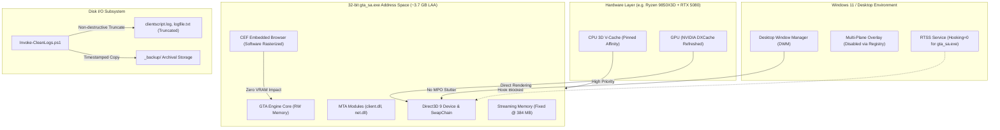
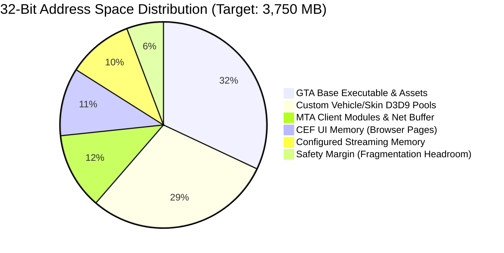

# System Architecture — ZeroStutter-MTA

> Technical Reference for System Engineers, Maintainers, and Autonomous Agents.

---

## 1. High-Level Architecture Overview



---

## 2. 32-Bit Memory Allocation Model (Large Address Aware)

Although running on 64-bit Windows with 64+ GB of system RAM, `gta_sa.exe` is a 32-bit binary compiled with the `/LARGEADDRESSAWARE` flag. Its user-mode virtual address space is strictly capped at **4,096 MB** (practically ~3,750 MB before allocator fragmentation causes `0xC0000005` out-of-memory faults).

### Virtual Address Space Breakdown Under Peak Load



### Why `streaming_memory = 384 MB` Is Mathematically Optimal:
* **The Default Trap (128–256 MB):** Results in aggressive texture thrashing and visible LOD popping when driving high-speed custom vehicles.
* **The Community Myth (512–1024 MB):** Allocates a massive contiguous block in virtual memory. Combined with custom server textures and CEF browser DOM trees, the total allocation breaches 3,800 MB, causing instant unhandled access violations in `client.dll` during dense server gatherings.
* **The Sweet Spot (384 MB):** Accommodates modern high-polygon vehicle models while reserving 200+ MB of headroom for allocator defragmentation.

---

## 3. Direct3D 9 Hook Collision Isolation

### The Problem
Monitoring utilities (RivaTuner Statistics Server, OBS Game Capture, Discord Overlay, GeForce Experience) inject DLL hooks into `Direct3DCreate9` and intercept `IDirect3DDevice9::Present`.

When MTA:SA starts, its anti-tamper subsystem and server kernel drivers (such as `FairplayKD.sys`) monitor entry points of graphics functions. When RTSS attempts to hook `Present` asynchronously while MTA is initializing its direct hooks, a race condition occurs:
1. Game initialization hangs at a black screen.
2. Kernel protection flags an integrity mismatch (`Warn #15` / `AC #4`).
3. Frame pacing degrades due to duplicate swapchain synchronization calls.

### The ZeroStutter Solution
Instead of terminating RTSS globally (which breaks monitoring for other modern games), we install an application-specific profile:
`C:\Program Files (x86)\RivaTuner Statistics Server\Profiles\gta_sa.exe.cfg` containing:
```ini
[Hooking]
EnableHooking=0
```
This instructs RTSS to completely skip hook injection into `gta_sa.exe`, restoring zero-latency native D3D9 presentation.

---

## 4. Disk I/O & Log Spam Suppression

Custom servers frequently generate excessive debug logging from client-side scripts. On a typical 2-hour session, `clientscript.log` and `logfile.txt` can accumulate over 500,000 redundant lines, causing:
1. Synchronous file flush pauses on the main render thread.
2. Micro-stutters during vehicle streaming when the disk queue length spikes.

ZeroStutter applies a two-tier suppression strategy:
1. **Engine Level:** `<filter_duplicate_log_lines>1</filter_duplicate_log_lines>` and `<max_clientscript_log_kb>1024</max_clientscript_log_kb>` in `coreconfig.xml`.
2. **Session Pipeline:** `Invoke-CleanLogs.ps1` runs pre-launch, archiving active logs to `_backup/` and truncating the live files to 0 bytes via safe stream sharing, ensuring zero file write latency.
